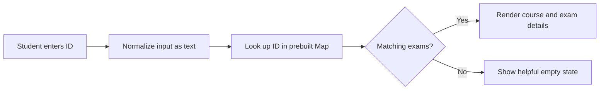

<div align="center">
  
  <h1>Nile University Midterm Schedule</h1>
  <p><strong>A fast, mobile-friendly exam lookup for the Fall 2026 midterm schedule.</strong></p>
  <p>
    <a href="https://mo-abdo28.github.io/midterm-schedule-fall-2026/">Open the live site</a>
    ·
    <a href="https://www.linkedin.com/in/mohamed-abdo-65310a361">Connect with Abdo</a>
  </p>
</div>

---

## Overview

Students can enter their university ID to retrieve the midterm exams associated with that ID. Each result includes the course, program when available, exam date, time, room, and facility type. The interface uses Nile University branding and adapts to desktop and mobile screens.

The Fall 2026 dataset currently contains **1,029 exam groups** and **4,816 unique student IDs**. A group represents one course sitting in a particular time and location; multiple IDs can map to the same group.

## Features

- **Indexed ID lookup:** the schedule is transformed into a `Map` once at startup, so each search resolves directly to the matching exams.
- **Useful exam details:** course code, program, date, time, room, and facility are shown when present in the source data.
- **Clear states:** the page guides students when the search field is empty or an ID has no matching schedule.
- **Responsive interface:** layouts, controls, and result cards adapt to narrow screens and support keyboard form submission.
- **Accessible semantics:** labeled form controls, visible focus styling, descriptive image text, and a live results region support assistive technology.
- **Static deployment:** the site runs on GitHub Pages without a server, build step, third-party runtime library, or external API.

## How it works



At page load, each exam group's student IDs are indexed to that exam. Search uses the full ID string rather than converting it to a number, preserving exact matches. The lookup and rendering run in the browser.

## Project structure

```text
.
├── index.html                     # Accessible responsive UI, lookup logic, and schedule data
├── assets/
│   └── nile-university-logo.jpg   # University logo used by the site and this README
└── README.md
```

## Run locally

No package installation is required. Open `index.html` in a modern browser, or serve this directory with any static file server. For example:

```bash
python -m http.server 8000
```

Then open <http://localhost:8000>.

## Schedule updates

The schedule is embedded in `index.html` as a JavaScript array. To update it, replace that array with the latest verified schedule while retaining each exam's `ids`, `subject`, `time`, `room`, and `date` fields. `program` and `facility` are optional. Dates use the `YYYY-MM-DD` format. Review representative IDs and exam details against the university's published schedule before deployment.

## Deploy

GitHub Pages serves this repository from the `main` branch root. Commit the updated site and asset files to `main`; Pages publishes the static files at:

<https://mo-abdo28.github.io/midterm-schedule-fall-2026/>

## Data and privacy

This is a convenience lookup, not an authenticated student portal. The schedule and IDs embedded in a public static site can be downloaded by anyone, even though the page only displays results after an ID search. Publish only schedule data that is approved for public access, and verify all exam details against official university communications.

## Credits

Built by **Abdo** for Nile University. The university logo shown here was provided for this project.
