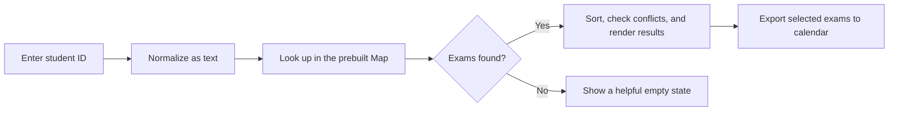

<div align="center">
  
  <h1>NU Midterm Finder</h1>
  <p><strong>A polished, mobile-first way to find your Fall 2026 midterm schedule.</strong></p>
  <p>
    <a href="https://mo-abdo28.github.io/midterm-schedule-fall-2026/"></a>
    <a href="https://www.linkedin.com/in/mohamed-abdo-65310a361"></a>
  </p>
  <p>
    
    
    
  </p>
  <p><em>Independent student project · Not an official Nile University service</em></p>
</div>

---

> **Privacy notice:** This is static hosting. Student IDs in the schedule file are public and can be downloaded; entering an ID is not authentication. The lookup remains public temporarily while the project owner seeks an approved NU integration. Do not use the site as a secure student portal.

## At a glance

| | |
|---|---|
| **Live demo** | [mo-abdo28.github.io/midterm-schedule-fall-2026](https://mo-abdo28.github.io/midterm-schedule-fall-2026/) |
| **Coverage** | 1,029 exam groups · 4,816 unique student IDs |
| **Runtime** | Plain HTML, CSS, and JavaScript · No packages or build step |
| **Hosting** | GitHub Pages from the `main` branch |
| **Schedule imported** | October 25, 2026 |

Students can search by ID to see their registered midterms, with the course, program where available, exam date, time, room, and facility.

## Product features

- **Instant lookup:** a prebuilt `Map` indexes student IDs to exam groups when the page loads.
- **Exam planning:** results sort by date and time, show a days-until countdown, and flag overlapping exam times.
- **Calendar export:** add an exam to a calendar with one click using an `.ics` event and Cairo local time.
- **Helpful states:** clear guidance for empty searches and IDs with no matching exams.
- **Shareable page:** use the device share sheet or copy the site link without putting a student ID in the URL.
- **Nile University branding:** supplied university logo, custom favicon, and social-preview metadata.
- **Responsive and accessible UI:** phone-friendly layouts, labeled controls, visible focus states, keyboard form submission, and live result announcements.
- **Official references:** shortcuts to the NU student portal and Registrar information for schedule verification.

## How the lookup works



IDs stay as strings so their exact representation is preserved. Calendar events use the exam's date, time, and room. The search and result rendering run entirely in the browser; there is no backend in this version.

## Repository layout

```text
.
├── index.html                     # Page structure and metadata
├── assets/
│   ├── app.js                     # Search index, UI states, calendar export, sharing
│   ├── favicon.svg                # Browser tab icon
│   ├── nile-university-logo.jpg   # University branding
│   └── styles.css                 # Responsive visual system
├── data/
│   └── schedule.js                # Fall 2026 schedule data
├── .github/
│   └── ISSUE_TEMPLATE/
│       └── site_issue.yml         # Privacy-aware issue form
├── CONTRIBUTING.md
└── README.md
```

## Run locally

No installation or build command is needed. Open `index.html` in a browser, or serve the repository with a static server:

```bash
python -m http.server 8000
```

Then visit <http://localhost:8000>.

## Update the schedule

The source data lives in `data/schedule.js`. Each exam group has this shape:

| Field | Type | Required | Description |
|---|---|:---:|---|
| `ids` | string array | Yes | Student IDs assigned to this sitting |
| `subject` | string | Yes | Course code |
| `date` | `YYYY-MM-DD` | Yes | Exam date |
| `time` | `HH:MM-HH:MM` | Yes | Start and end time |
| `room` | string | Yes | Room or lab identifier |
| `program` | string | No | Academic program name |
| `facility` | string | No | Room, lab, hall, or other facility type |

Replace the schedule array with the latest approved workbook data. Check representative course codes, dates, times, and rooms against the official schedule before publishing. See [CONTRIBUTING.md](CONTRIBUTING.md) for the update workflow.

## Deploy

GitHub Pages serves the repository root from `main`. Push the updated site and assets to that branch; the live URL is:

<https://mo-abdo28.github.io/midterm-schedule-fall-2026/>

## Privacy and official access

The public `data/schedule.js` file contains student IDs and exam assignments. Separating the data from the interface makes updates easier, but it does **not** make the data private. A university-approved API or single sign-on (SSO) integration is needed before the lookup can be treated as authenticated. No student passwords, session cookies, or private API credentials belong in this repository.

For academic information, use the [official NU student portal](https://register.nu.edu.eg/AppFormProd/Home.aspx) and [Registrar information](https://nu.edu.eg/students/services-facilities/registrar). This project is an independent student-made convenience tool and is not affiliated with or operated by Nile University.

## Report a site issue

Use the repository's issue form for display or functionality problems. **Never include a student ID, password, personal schedule, or screenshot containing student data in a public issue.** For changes to official exam information, verify with the university first.

## Credits

Built by **Abdo**. The Nile University logo was supplied for this project.
